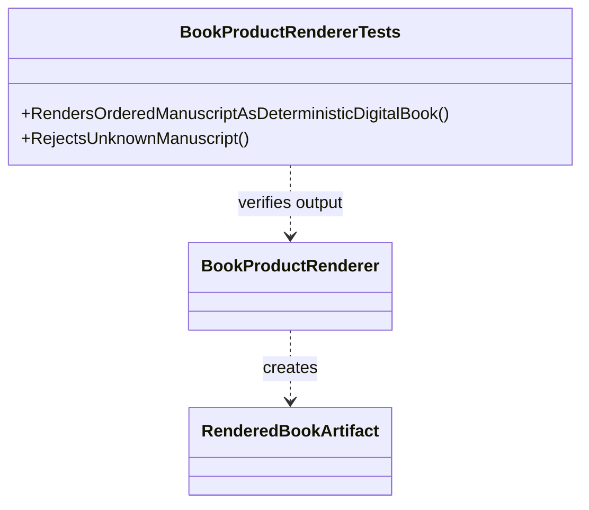

# BookProductRendererTests UML

## Use cases

- Render a manuscript into stable Markdown with normalized line endings.
- Preserve event references as artifact metadata.
- Reject an unknown manuscript identity.
