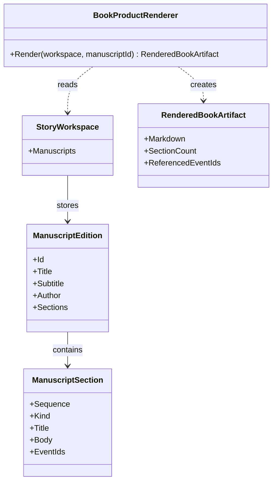

# BookProductRenderer UML

## Use cases

- Render the current manuscript as deterministic Markdown.
- Use the exact same output renderer after package validation and workspace restoration.
- Keep physical printing and immutable publication editions outside this initial output service.
