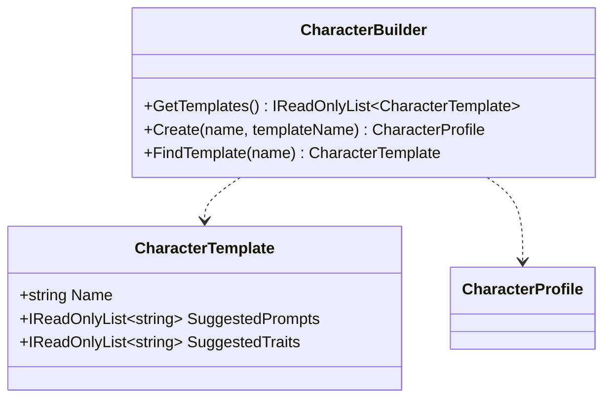

# CharacterBuilder UML

## Class diagram

## Use case

Opening Casting creates a useful draft immediately. The author may select a template or ignore the prompts and start writing. Suggestions remain suggestions until the author adds them.
