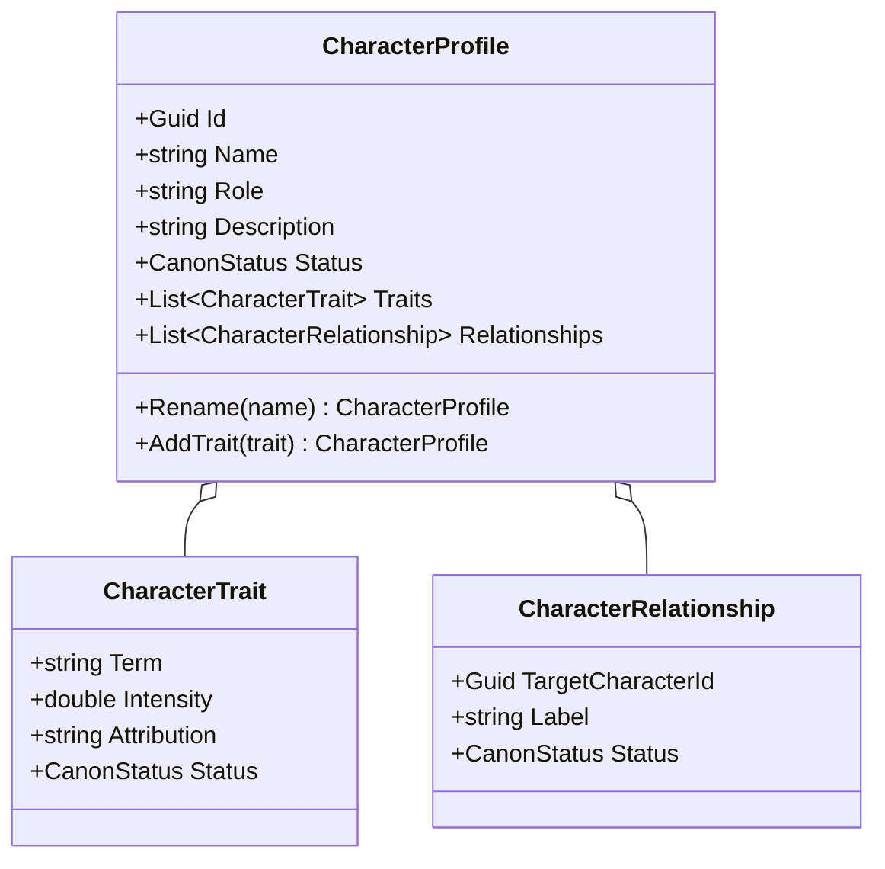

# CharacterProfile UML

## Class diagram

## Use case

A user opens Casting, starts an optional template, and creates a draft without completing a biography. Traits are stored with surface wording and attribution; later edits preserve the character's identity.
