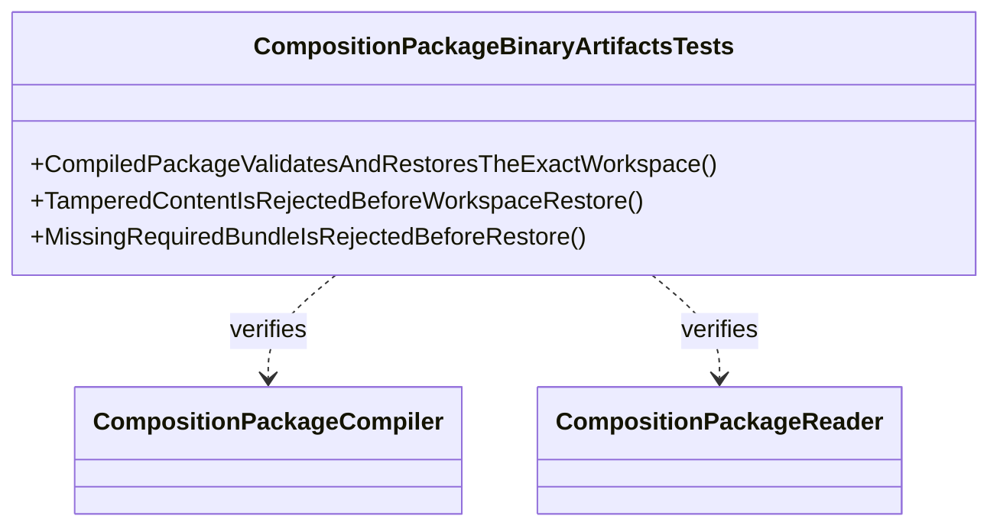

# CompositionPackageBinaryArtifactsTests UML

## Use cases

- Prove round-trip of a compiled book package.
- Reject content tampering before restoring authoring state.
- Reject unavailable required host capabilities without rerunning arbitration.
