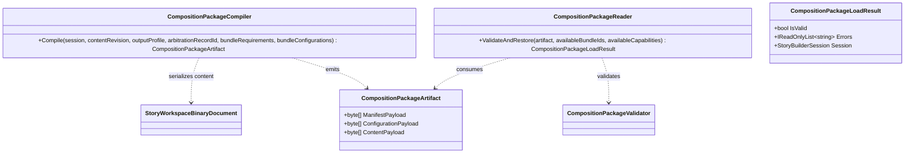

# CompositionPackageBinaryArtifacts UML

## Use cases

- Workshop emits a content payload and resolved manifest/configuration after arbitration.
- AnyApp-side adapter validates the package against available bundle IDs and capabilities.
- A valid package restores the same workspace identity; invalid or tampered payloads fail before use.
