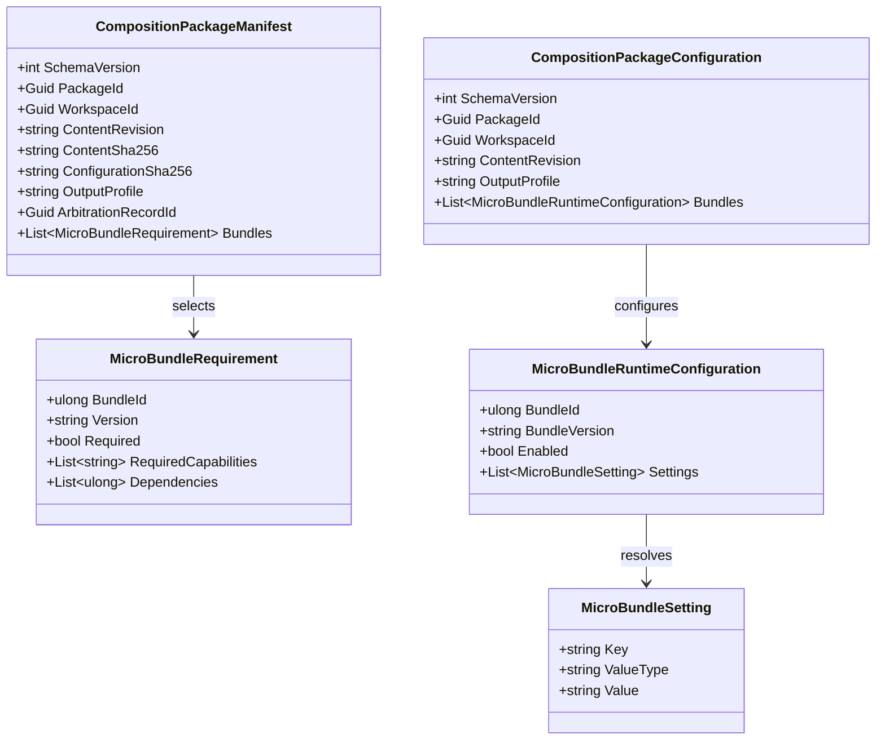

# Composition Package Contracts UML

## Use cases

- Workshop records selected MicroBundles, versions, required capabilities, and the arbitration record in a manifest.
- Workshop stores resolved per-bundle settings in a configuration tied to the same package, workspace, and content revision.
- AnyApp validates the captured result and rejects incompatible packages without repeating arbitration.
- A new content revision or arbitration result creates a new package identity/revision rather than silently reusing stale configuration.
