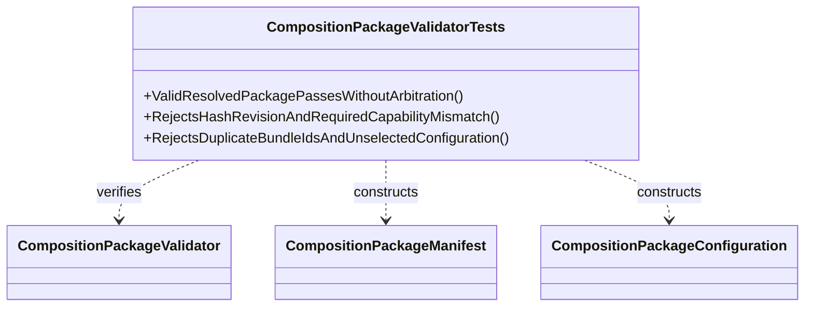

# CompositionPackageValidatorTests UML

## Use cases

- Confirm the host can validate a package without rerunning Workshop arbitration.
- Exercise stale-content and missing-capability rejection paths.
- Protect the contract from duplicate or unselected bundle configuration.
