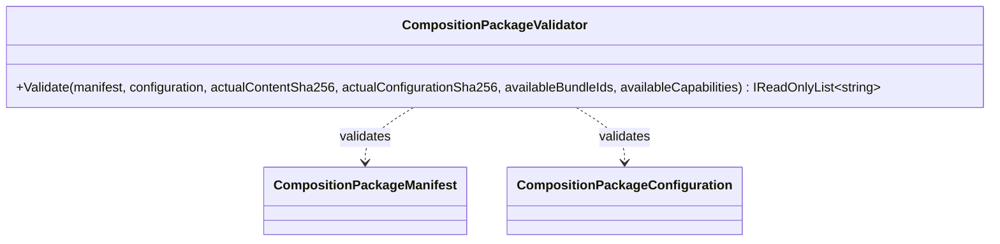

# CompositionPackageValidator UML

## Use cases

- Verify content and configuration hashes before a host loads the package.
- Reject a required bundle or capability missing from the host.
- Reject manifest/configuration identity or version mismatches.
- Report validation issues without mutating the package or invoking arbitration.
