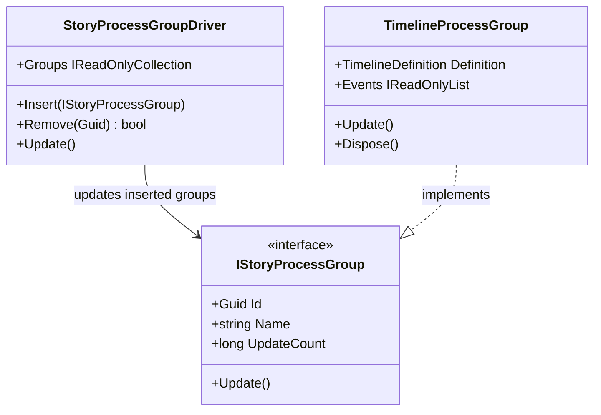

# IStoryProcessGroup UML

## Use cases

- Insert a compatible process group into a host-neutral driver.
- Let the driver advance each inserted group once per driver Update.
- Implement another adapter without adding its execution engine to StoryBuilder.Core.

## Boundary

The interface is a scheduling seam, not a scheduler or a promise that every runtime provider is installed.
