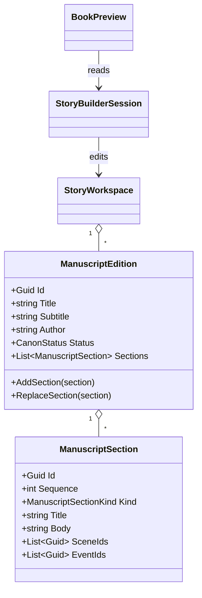

# ManuscriptEdition UML

## Use cases

- Compose a working book from ordered sections.
- Revise section text and refresh the actual product preview.
- Preserve section links to scenes and events for future timeline navigation.
- Keep a working manuscript distinct from an immutable published edition.
