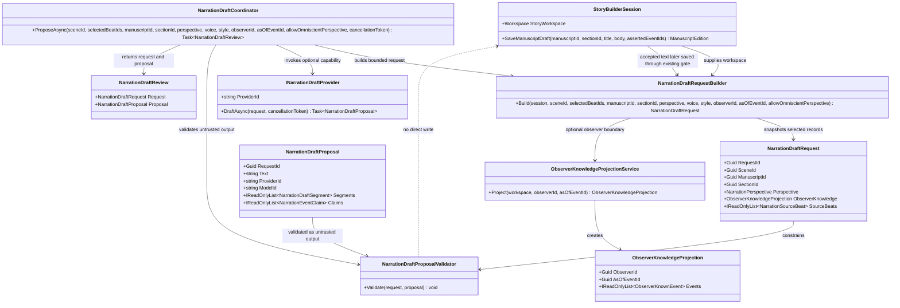

# Narration Draft Request Flow UML

## Use cases

- Build a drafting request from an explicitly selected scene, beat set, manuscript, and section.
- Constrain a request to an observer's accepted knowledge at a causal event horizon.
- Reject selected beats that are not grounded in the observer projection.
- Validate provider text ranges and event claims before showing the proposal for author review.
- Persist accepted text and event provenance only through the existing manuscript save operation.

## Non-goals

- The host may supply an optional provider through `INarrationDraftProvider`; no concrete provider is bundled or registered by the current WebDemo.
- This flow does not choose an LLM, generate creative prose by itself, or silently mutate canon.
- It does not expose the complete workspace to a provider.
- It does not replace the host's author-review UI or the atomic manuscript save gate.
