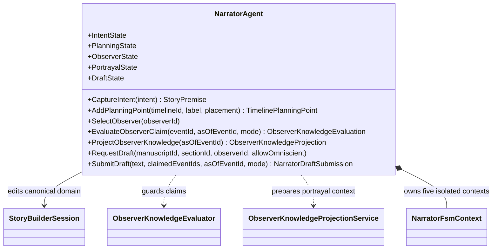

# NarratorAgent UML

## Cooperating state machines

- **Intent:** Idle → Captured → Ready
- **Planning:** Empty → Anchored → Specified
- **Observer:** Unselected → Selected → Allowed / Blocked
- **Portrayal:** Idle → Requested → Ready / NeedsReview
- **Draft/review:** Idle → Requested → Ready / NeedsReview

## Use cases

- Capture a premise and add an unresolved timeline point.
- Evaluate a claim under an explicit observer and event anchor.
- Prepare a constrained portrayal context without changing observer-evaluation state.
- Request review when the observer has no accepted knowledge at the chosen anchor.
- Hold a draft for review if a declared claim is unsupported.
- Save approved draft text and link its declared event identities to the manuscript section.
