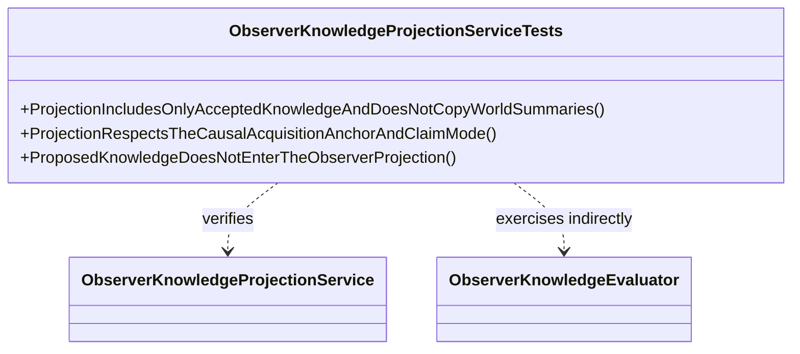

# ObserverKnowledgeProjectionServiceTests UML

## Use cases

- A witnessed event appears as an accepted direct fact.
- A later report appears only after the observer acquires it and only in an allowed framing.
- Unaccepted or unknown events are not exposed in the observer projection.
