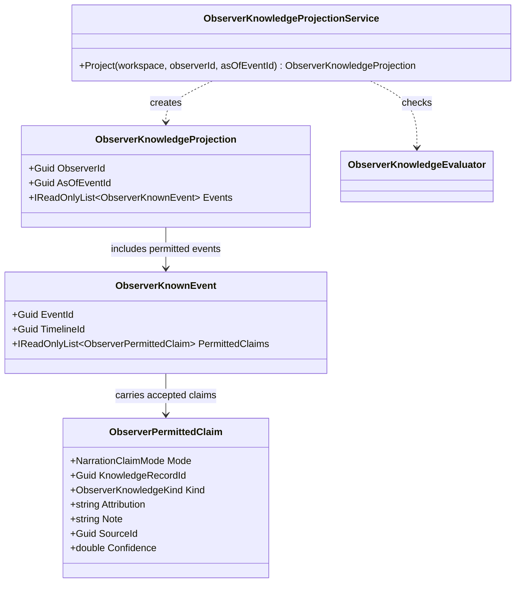

# ObserverKnowledgeProjection UML

## Use cases

- Build an observer-specific view of accepted knowledge at a causal event anchor.
- Give downstream narration/portrayal providers only the accepted notes and modes that may support claims.
- Keep world truth, observer knowledge, and representation detail as separate layers.
