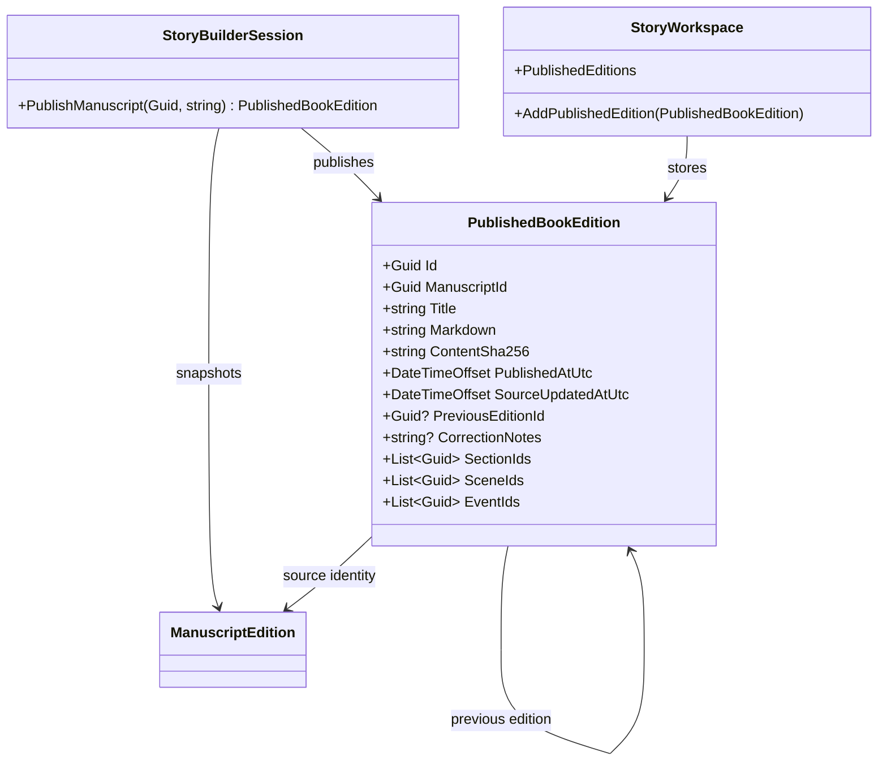

# PublishedBookEdition UML

## Use case

An author publishes a working book, makes a correction later, and publishes again. The original Markdown remains unchanged; the correction is a new hashed artifact linked to its predecessor.
