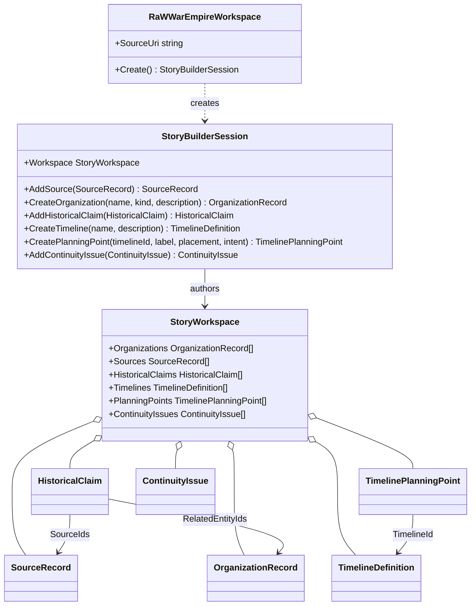

# RaWWar Empire Workspace Builder — UML

The Quickstart builder composes existing StoryBuilder domain records. It does not introduce a raWWar-specific type into the generic StoryBuilder core.

## Lifecycle

- The source record retains the canonical raWWar document URI.
- House organizations start as Draft.
- Source-backed claims and continuity issues start as Proposed.
- Timeline anchors remain unresolved placeholders until authors supply chronology.
- No StoryEvent records are fabricated by this builder.
