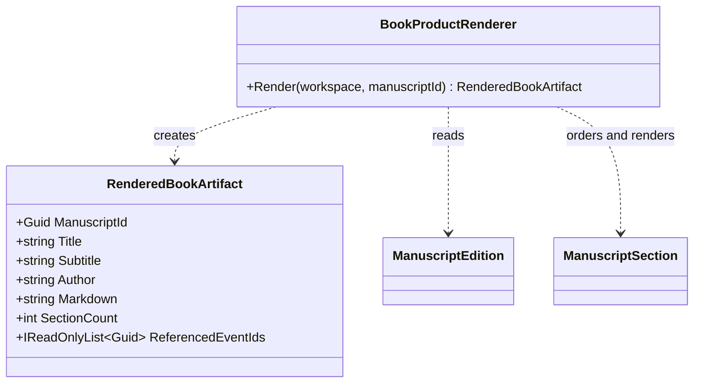

# RenderedBookArtifact UML

## Use cases

- Produce a deterministic digital book from the current manuscript.
- Preserve stable event references in product metadata for timeline and observer views.
- Consume the same manuscript after binary package restoration without repeating arbitration.
