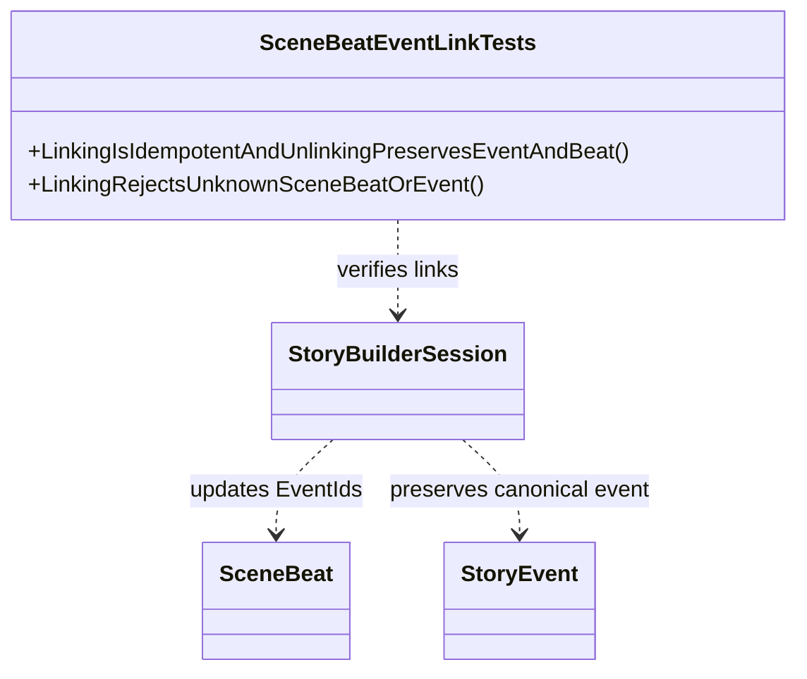

# SceneBeatEventLinkTests UML

## Use cases

- Link an event to a scene beat without duplicating it.
- Remove a link without deleting the scene beat or world event.
- Reject missing scene, beat, or event identities.
