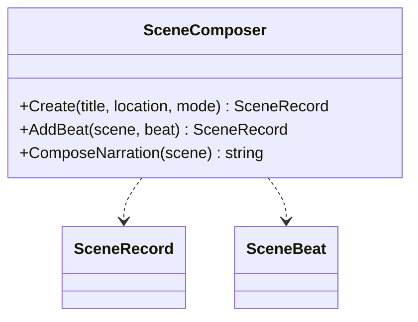

# SceneComposer UML

## Class diagram

## Use case

After a player or author records beats, the composer produces an editable narration draft in sequence order. It does not silently fill gaps in the record.
