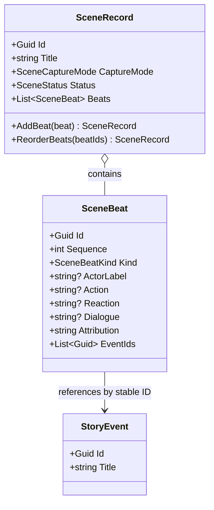

# SceneRecord UML

## Class diagram

## Use cases

- Capture a scene as ordered actions and reactions.
- Link an event to the exact beat that portrays it.
- Reorder beats without duplicating or mutating the referenced world event.
