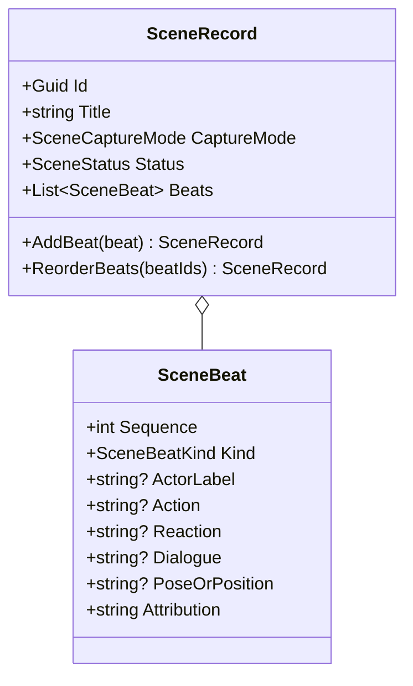

# SceneRecord UML

## Class diagram

## Use case

Capture a fight as ordered actions and reactions, play it out, or represent it as a pose sequence. The same ordered beats can become a first-pass narrative draft without claiming to simulate the fight.
