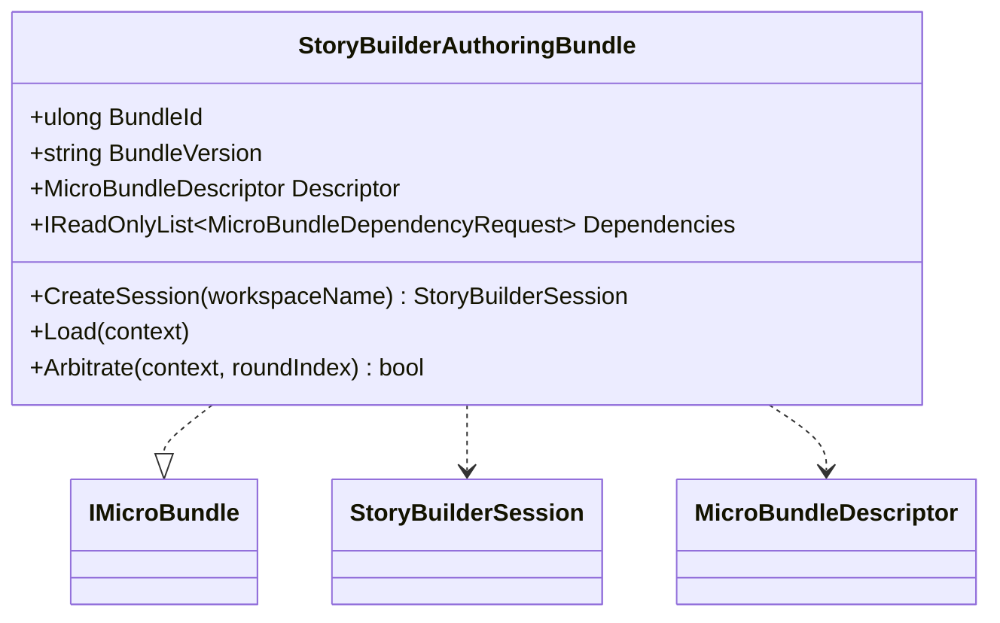

# StoryBuilderAuthoringBundle UML

## Class diagram

## Use case

A host catalog resolves the bundle by stable ID and version. FSM_COS loads it as part of a runtime assembly. The host retrieves the bundle and creates an isolated StoryBuilderSession for a user or campaign. The bundle declares capabilities but does not own the composition kernel, user interface, or persistent storage.
