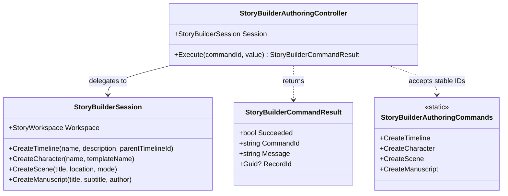

# StoryBuilderAuthoringController UML

## Use cases

- Create a timeline, character, scene, or manuscript using an existing domain operation.
- Reject unsupported commands without mutating the session.
- Return a stable record ID and human-readable outcome to a host.
- Let AnyApp bind native controls explicitly without adding WPF dependencies to StoryBuilder.
