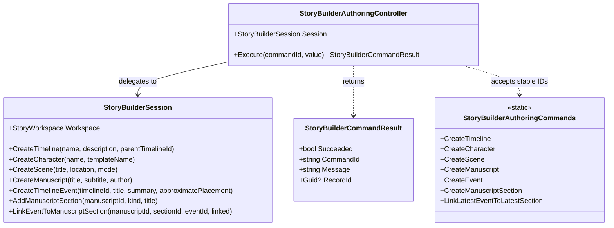

# StoryBuilderAuthoringController UML

## Use cases

- Create a timeline, character, scene, or manuscript using an existing domain operation.
- Create a canonical event on the first timeline, creating a default timeline if necessary.
- Create a manuscript passage, creating a default manuscript if necessary.
- Link the latest event to the latest passage by stable identity; reject the link without mutation when prerequisites are absent.
- Reject unsupported commands without mutating the session.
- Return a stable record ID and human-readable outcome to a host.
- Let AnyApp bind native controls explicitly without adding WPF dependencies to StoryBuilder.
