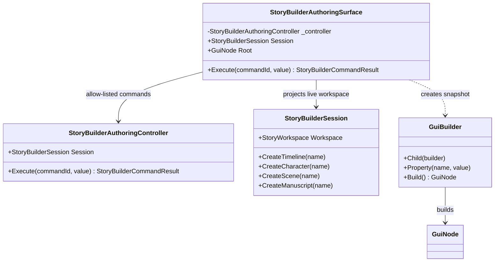
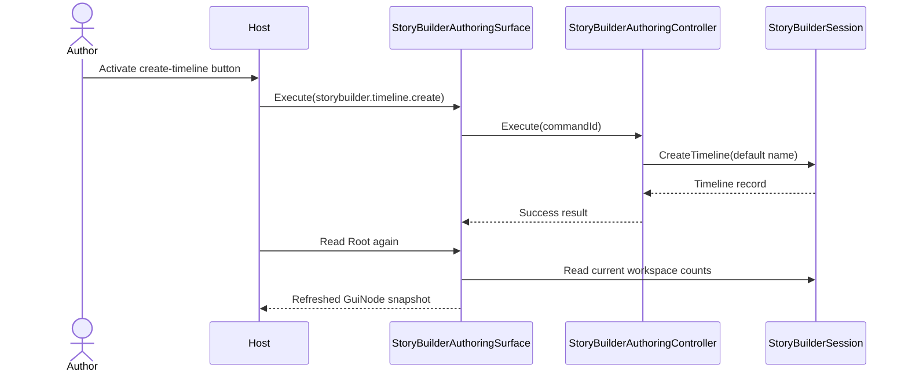

# StoryBuilderAuthoringSurface UML

## Class diagram

## Use case: create and refresh

## Responsibility boundary

- StoryBuilder owns records and the bounded command vocabulary.
- The surface projects current state into GUI.Core's semantic tree; it does not render native controls.
- The host binds command IDs to this surface and re-renders after execution.
- Unknown commands must remain rejected; display text must never be treated as an operation identifier.
