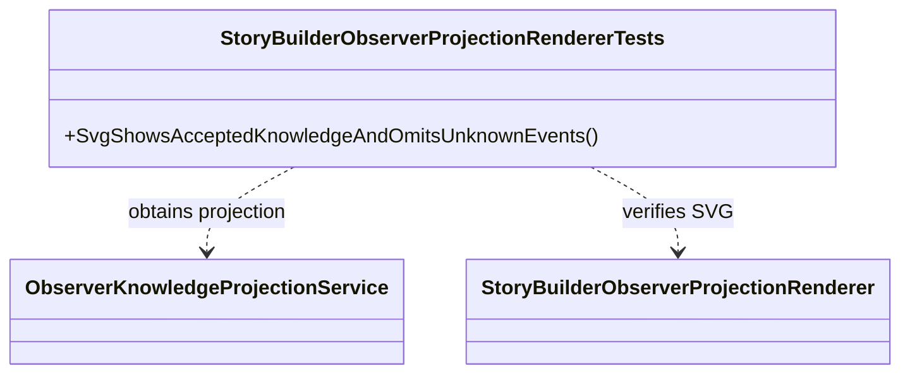

# StoryBuilderObserverProjectionRendererTests UML

## Use cases

- Accepted observer knowledge appears in the generated view.
- Unknown event titles and unrestricted world summaries do not appear in the view.
