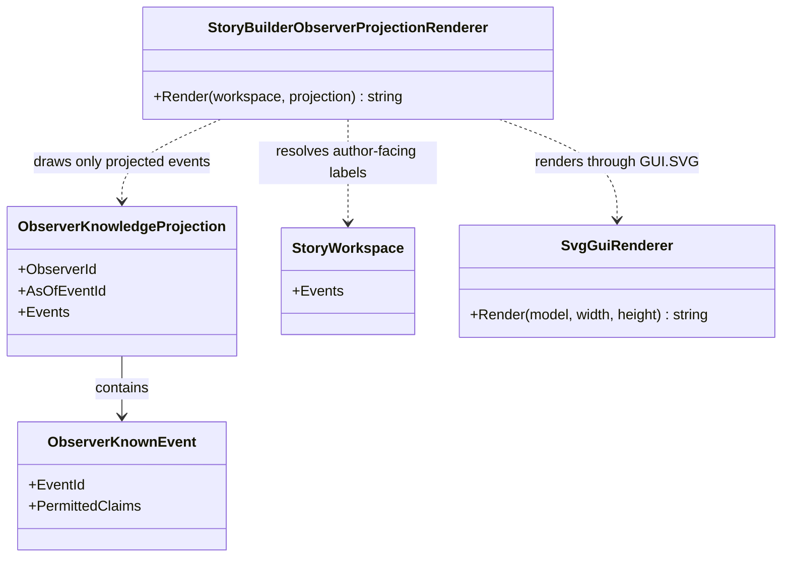

# StoryBuilderObserverProjectionRenderer UML

## Use cases

- Show the author which accepted claims are available to a selected observer at a chosen event anchor.
- Display the allowed narration mode and accepted note for each projected event.
- Omit unknown events from the SVG rather than rendering the whole world and styling hidden items afterward.
