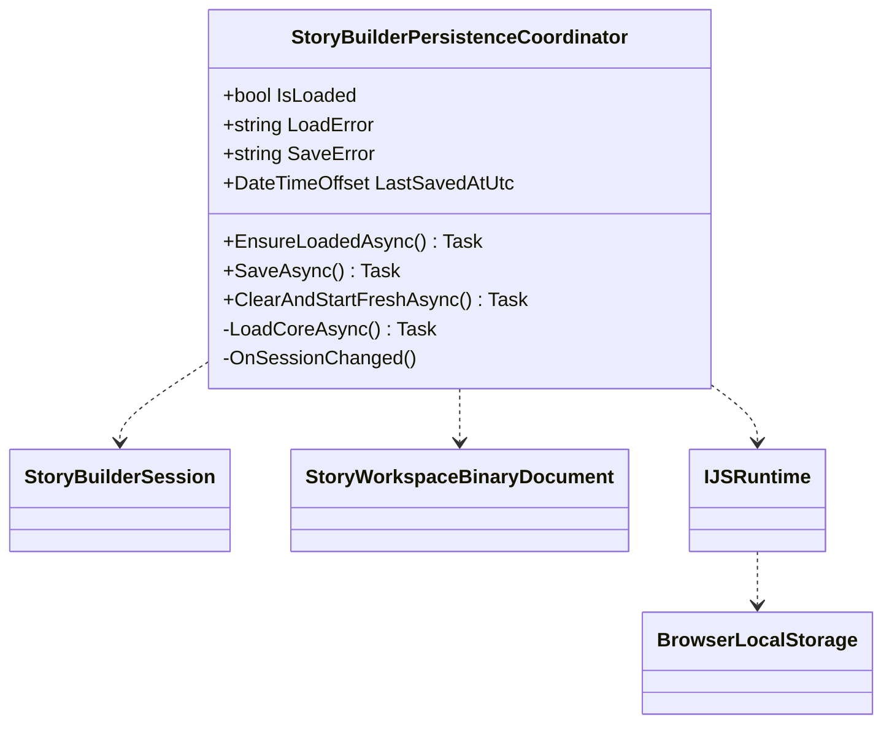

# StoryBuilderPersistenceCoordinator UML

## Class diagram

## Use case

After the interactive browser connection is available, the layout loads a versioned binary workspace from localStorage. Subsequent StoryBuilderSession mutations trigger serialized saves. Corrupt or unreadable saved data is left untouched until the user explicitly chooses to reset it.
