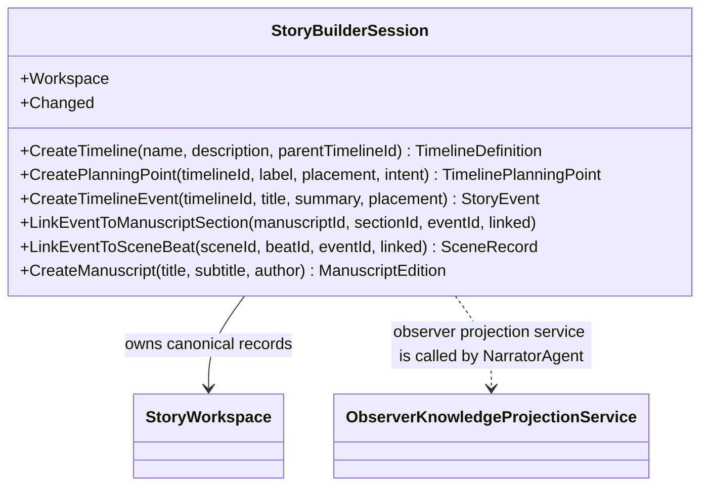

# StoryBuilderSession UML

## Use cases

- Coordinate timeline, manuscript, and scene-beat authoring without coupling the core to a host.
- Keep event-to-manuscript and event-to-beat links as relationships to one stable world-event identity.
- Notify living views when records change.
