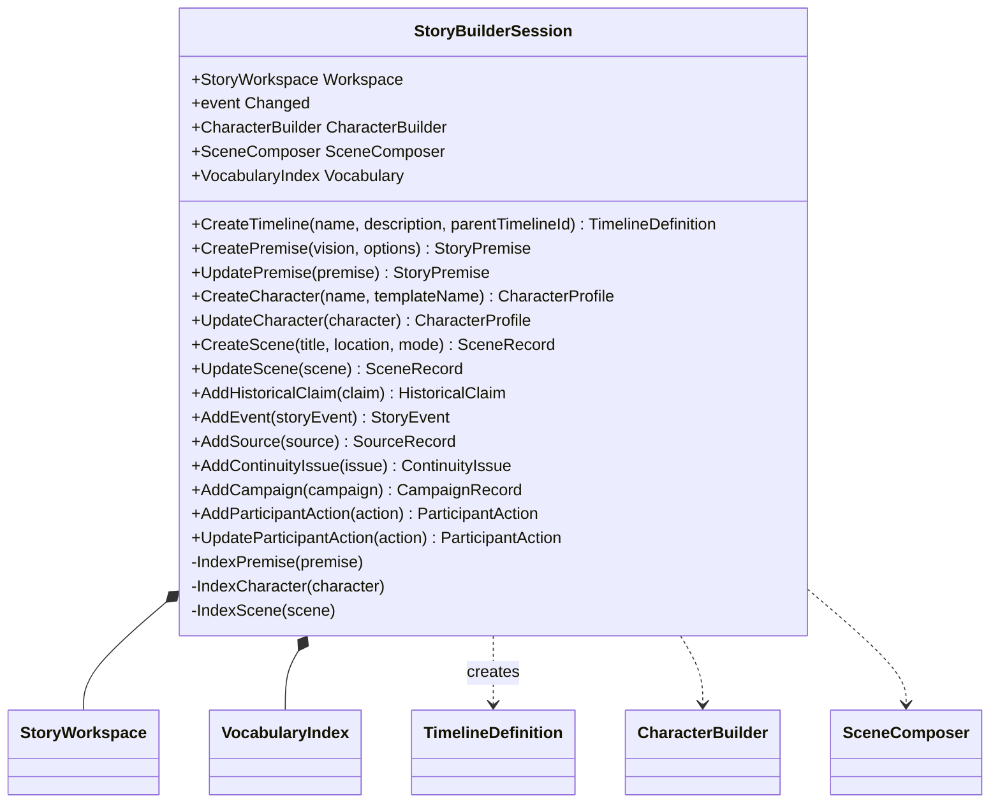

# StoryBuilderSession UML

## Class diagram

## Use case

The Narrator, timeline authoring, Casting, and Stage route edits through one workspace session. CreateTimeline registers canonical timeline definitions and supports branch lineage without replacing the parent. Premise, character, and scene edits refresh the corresponding vocabulary occurrences. Host adapters observe Changed to autosave the workspace without coupling the domain to a storage technology.
