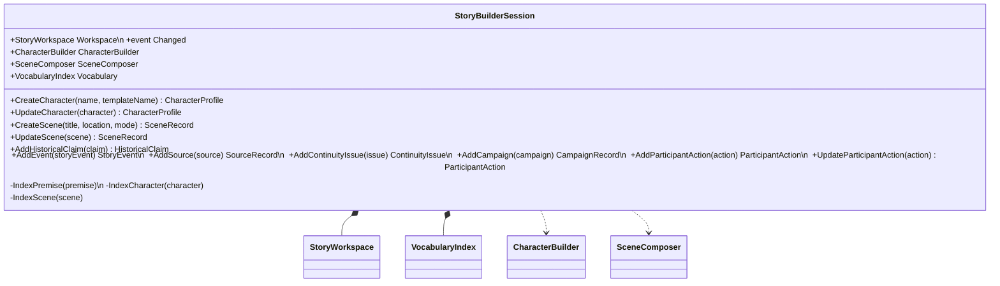

# StoryBuilderSession UML

## Class diagram

## Use case

The Narrator, Casting, and Stage route edits through one workspace session. When a character trait or scene beat changes, the session removes that target's previous word occurrences and indexes the updated record. Searches therefore follow edits instead of preserving stale counts.
