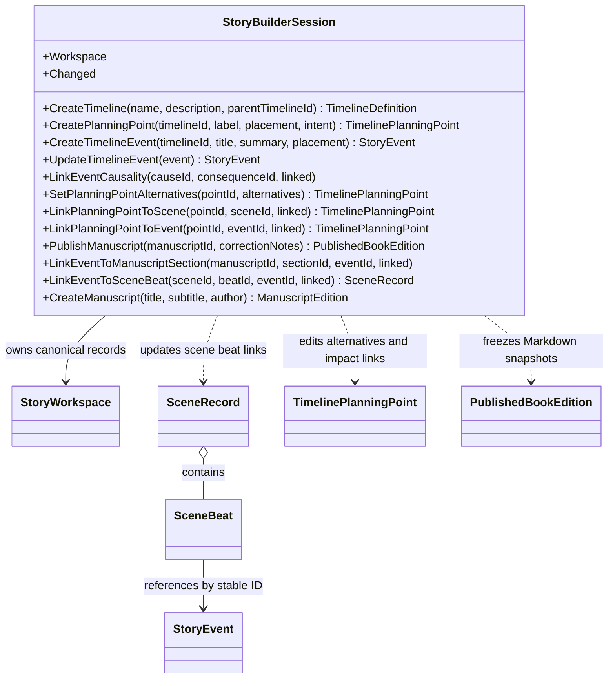

# StoryBuilderSession UML

## Use cases

- Coordinate timeline, manuscript, and scene-beat authoring without coupling the core to a host.
- Keep event-to-manuscript and event-to-beat links as relationships to one stable world-event identity.
- Edit cause/consequence edges reciprocally and inspect cycles without silent repairs.
- Explore provisional alternatives without promoting them automatically to story canon.
- Freeze a manuscript publication and link corrected editions without rewriting prior output.
- Notify living views when records change.
