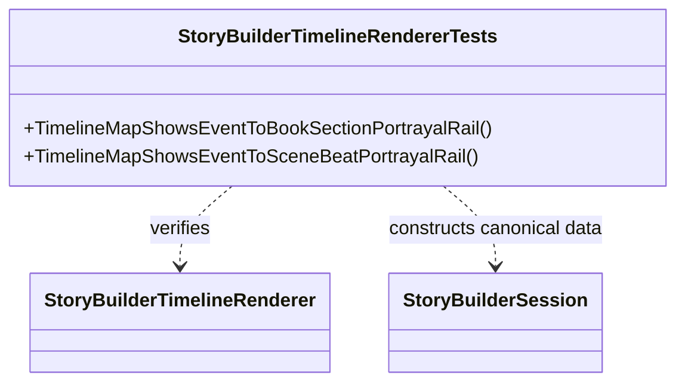

# StoryBuilderTimelineRendererTests UML

## Use cases

- A manuscript section references an event and appears on the book portrayal rail.
- A scene beat references the same event and appears on the scene-beat rail.
