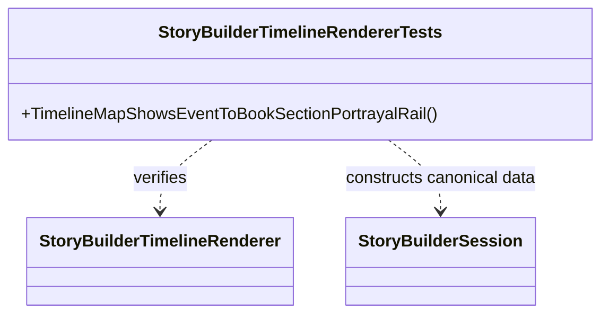

# StoryBuilderTimelineRendererTests UML

## Use cases

- A world event is assigned to a timeline.
- A manuscript section references that event.
- The generated SVG shows the event and the section that portrays it.
