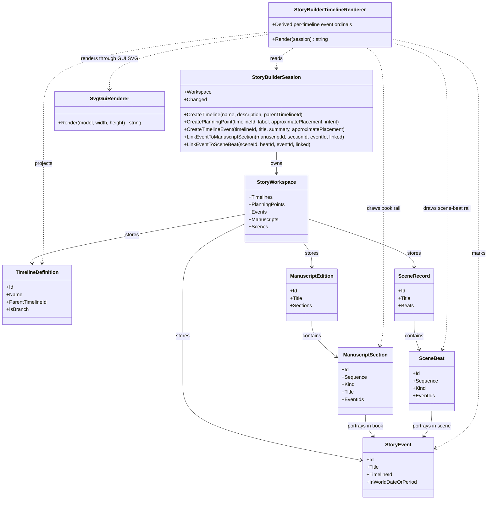

# StoryBuilderTimelineRenderer UML

## Class diagram

## Use cases

- **Create a root:** the author creates a timeline with no parent and sees a root node.
- **Branch a history:** the author selects an existing parent, creates a child timeline, and sees the declared relationship.
- **Place an event:** the author adds a key event with approximate or unresolved placement; a numbered event marker is drawn on its timeline.
- **Link event to product:** a manuscript section references the event by stable ID and appears on the book portrayal rail.
- **Link event to scene beat:** a beat references the same event ID and appears on the scene-beat rail.
- **Keep the model authoritative:** refresh or restore the workspace and rebuild the diagram from canonical records; SVG is not a persistence layer.

## Scope boundary

Parent connectors represent branch lineage. Book portrayal connectors represent where a world event is recounted in manuscript order. Scene-beat connectors represent where the event is enacted or observed in the scene record. None of these relationships alone implies causality or measured world chronology.
