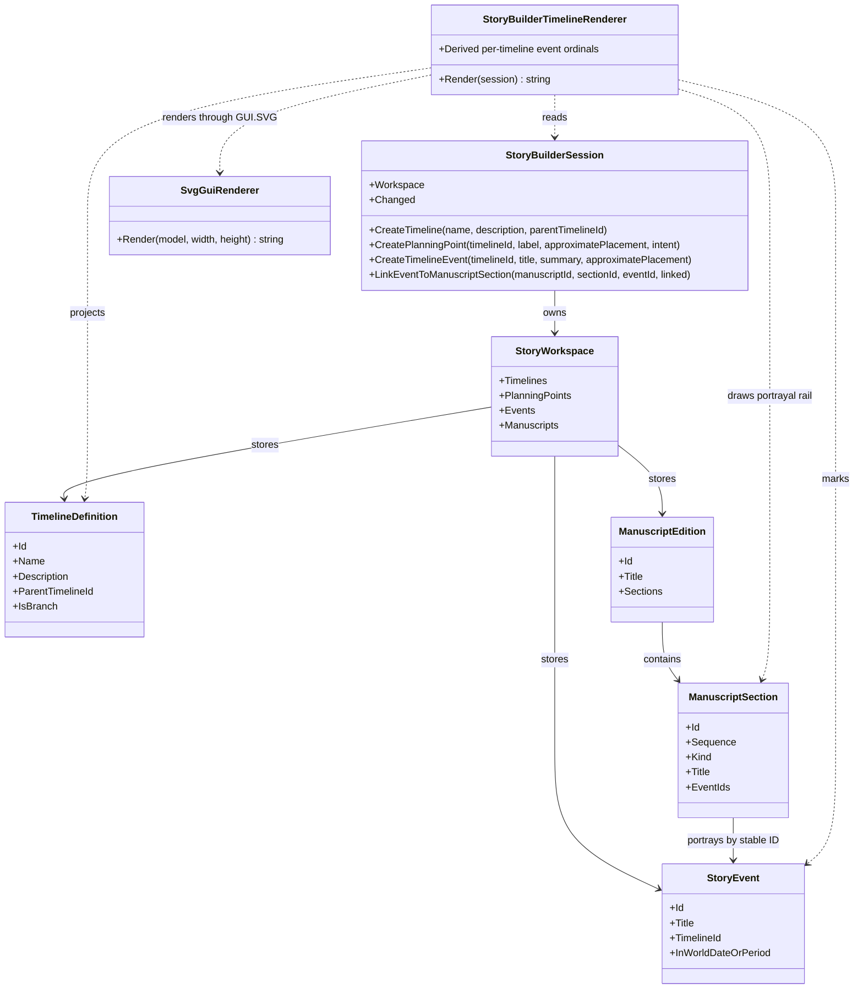

# StoryBuilderTimelineRenderer UML

## Class diagram

## Use cases

- **Create a root:** the author creates a timeline with no parent and sees a root node.
- **Branch a history:** the author selects an existing parent, creates a child timeline, and sees the declared relationship.
- **Place an event:** the author adds a key event with approximate or unresolved placement; the numbered event marker is drawn on its timeline; the same view ordinal appears on its portrayal rail. This ordinal is a visual label, not a replacement for the event's stable GUID.
- **Link event to product:** a manuscript section references the event by stable ID and appears on the portrayal rail with the actual book and section titles.
- **Keep the model authoritative:** refresh or restore the workspace and rebuild the diagram from canonical records; SVG is not a persistence layer.

## Scope boundary

Parent connectors represent branch lineage. Portrayal connectors represent where a world event is recounted in manuscript order. Neither one implies causality or measured world chronology. Scene/beat-level links and observer-aware recountings remain future work.
