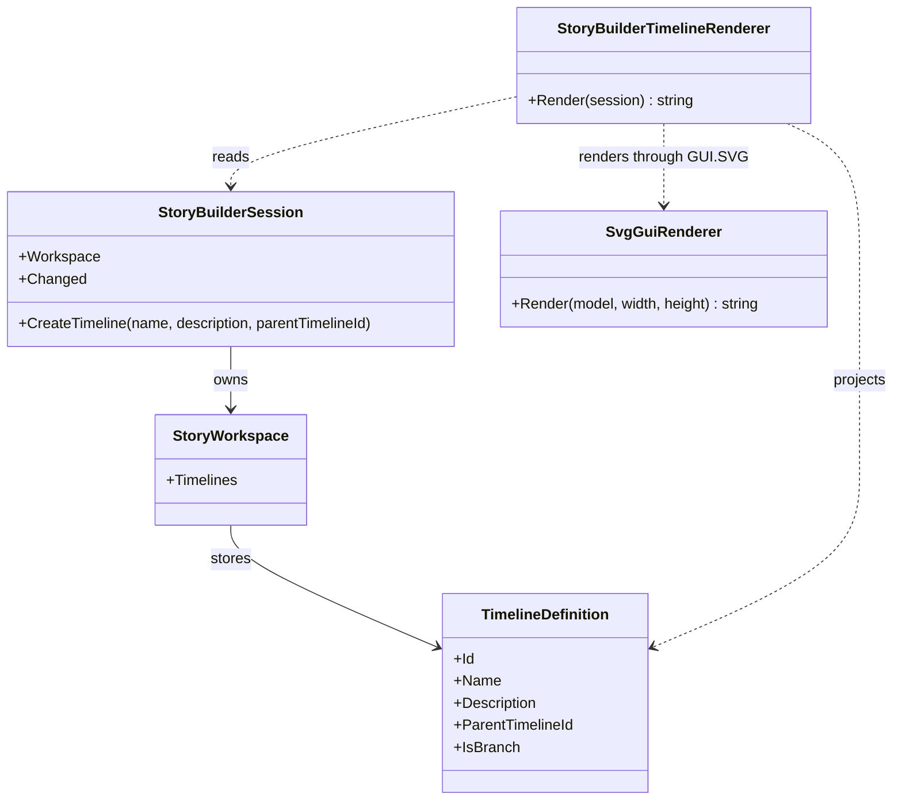

# StoryBuilderTimelineRenderer UML

## Class diagram

## Use cases

- **Create a root:** the author creates a timeline with no parent and sees a root node.
- **Branch a history:** the author selects an existing parent, creates a child timeline, and sees the declared relationship.
- **Keep the model authoritative:** refresh or restore the workspace and rebuild the diagram from timeline records; SVG is not a persistence layer.

## Scope boundary

This view does not yet draw world events, divergence points, event causality, scene links, character knowledge, or manuscript order. Those need explicit domain relationships before the visualization can claim to show them.
