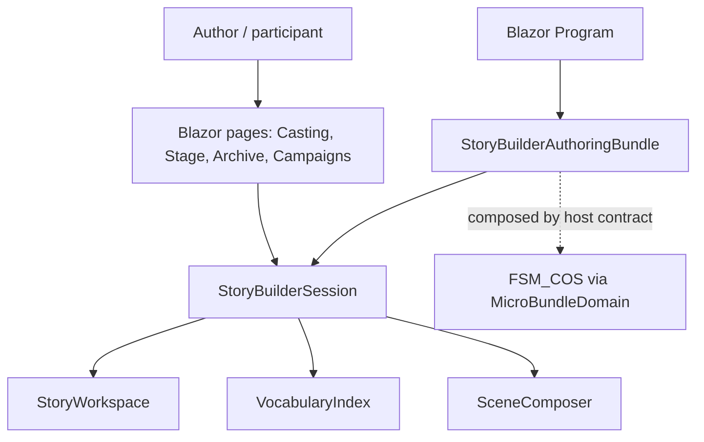

# StoryBuilder WebDemo UML

## Component diagram

## Use case

The host creates a scoped StoryBuilderSession through the MicroBundle capability factory. Users create and revise characters, scenes, claims, and campaign choices. Session operations update the workspace and vocabulary index; scene beats generate an editable narration draft. Data is local to the current circuit and is not persisted.
