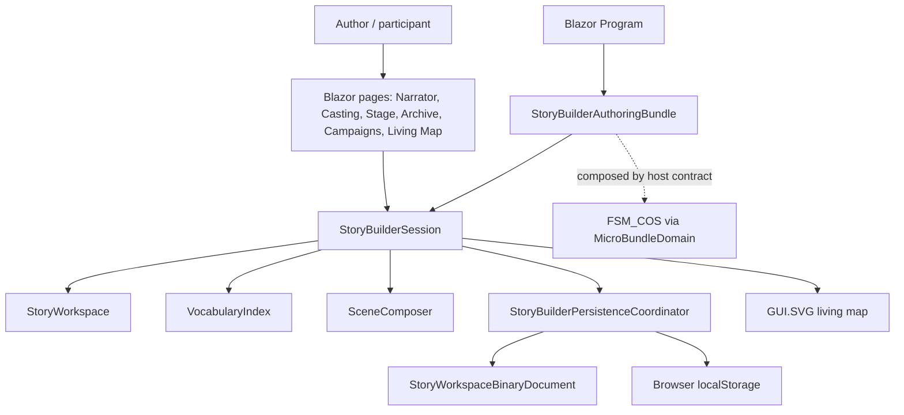

# StoryBuilder WebDemo UML

## Component diagram

## Use case

The host creates a scoped StoryBuilderSession through the MicroBundle capability factory. The Narrator captures editable premise proposals; Casting manages character profiles and story-function roles; the Living Map renders the current records through GUI.SVG. Session changes trigger a versioned binary autosave to browser localStorage. Data remains local to this browser and is not cloud-synchronized.
