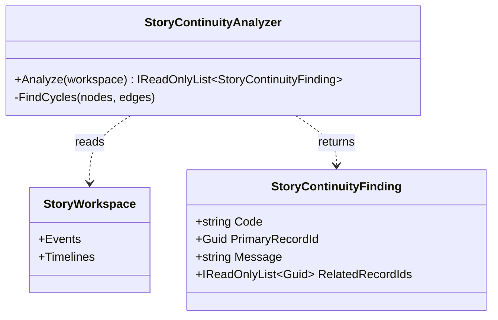

# StoryContinuityAnalyzer — UML and use cases

**Purpose:** Analyze a StoryBuilder workspace for causal and timeline-branch graph conflicts without changing the workspace.

## Class diagram

## Use cases

- **Review a story:** run `Analyze(workspace)` and display each finding with its related record IDs.
- **Repair a causal graph:** use the finding's code and record IDs to inspect mismatched cause/consequence links or a causal cycle.
- **Repair timeline branches:** inspect the timeline IDs in a branch-cycle finding and correct the parent references.
- **Verify a repair:** run the analyzer again; resolved findings no longer appear.

The analyzer is read-only. It does not decide canon, infer chronology from prose, or automatically rewrite author records.
