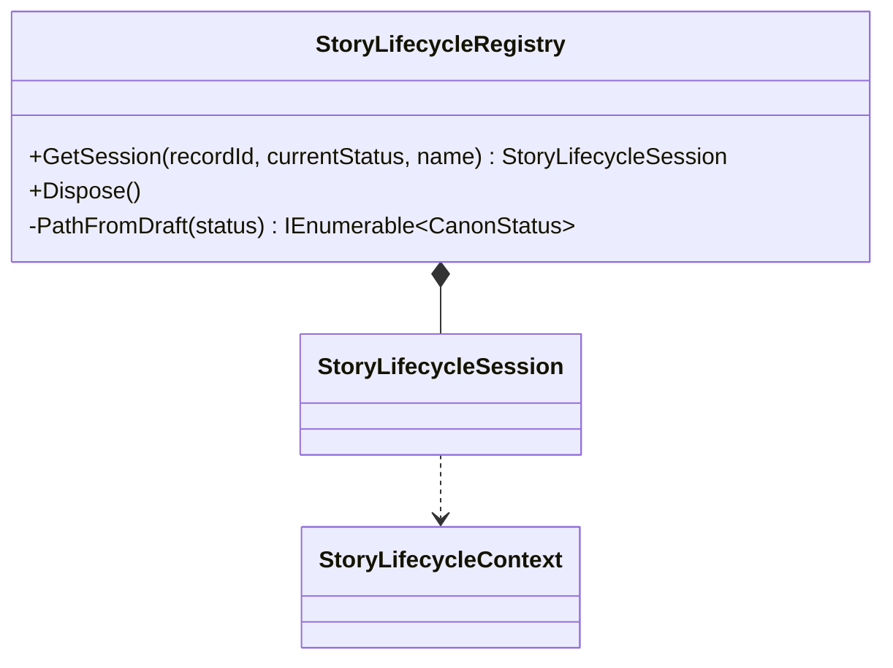

# StoryLifecycleRegistry UML

## Class diagram

## Use case

A scoped host registry creates or returns the FSM_API lifecycle session associated with a record ID. It can reconstruct a supported lifecycle from the current status after a component is revisited, and it disposes all sessions with the host scope.
