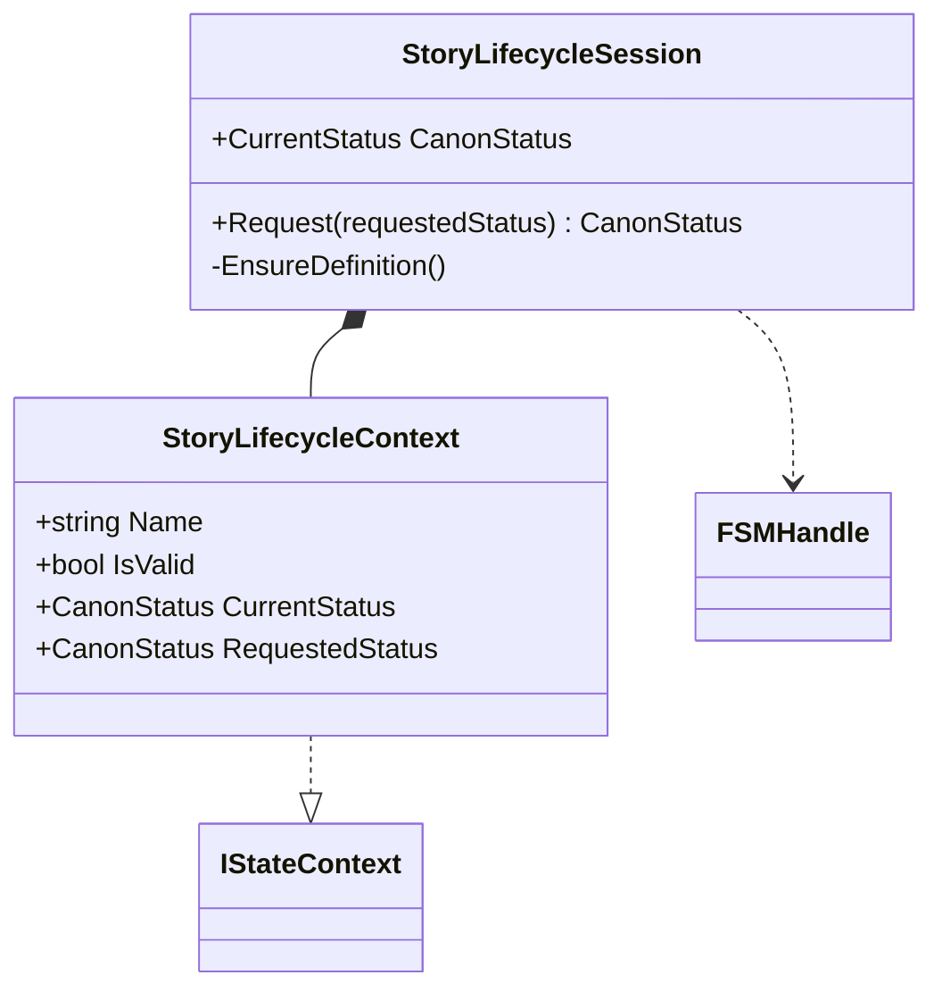

# StoryLifecycleSession UML

## Class diagram

## Use case

A host asks the optional adapter to propose or accept a record. FSM_API evaluates the allowed state transition; the adapter reports the state actually reached. The base domain core remains usable without FSM_API.
