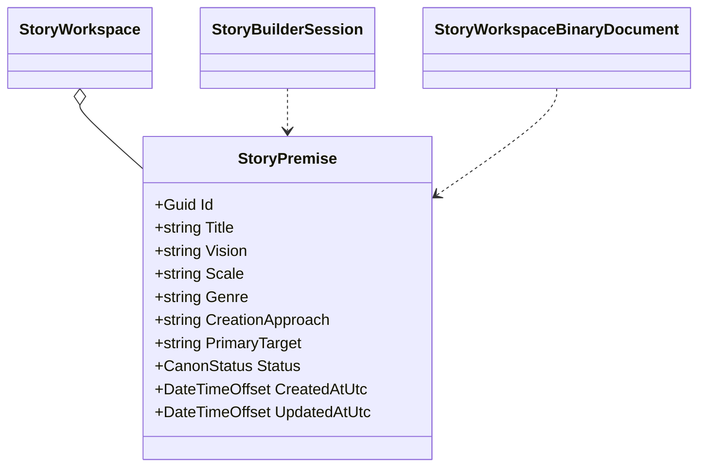

# StoryPremise UML

## Class diagram

## Use case

The Narrator turns a creator's first free-form idea into a stable, editable proposal. Optional scale, genre, approach, and target preferences are recorded only when provided. The premise remains distinct from the StoryBuilder tool's own ExperienceDefinition and is not accepted as canon until the creator chooses to accept it.
