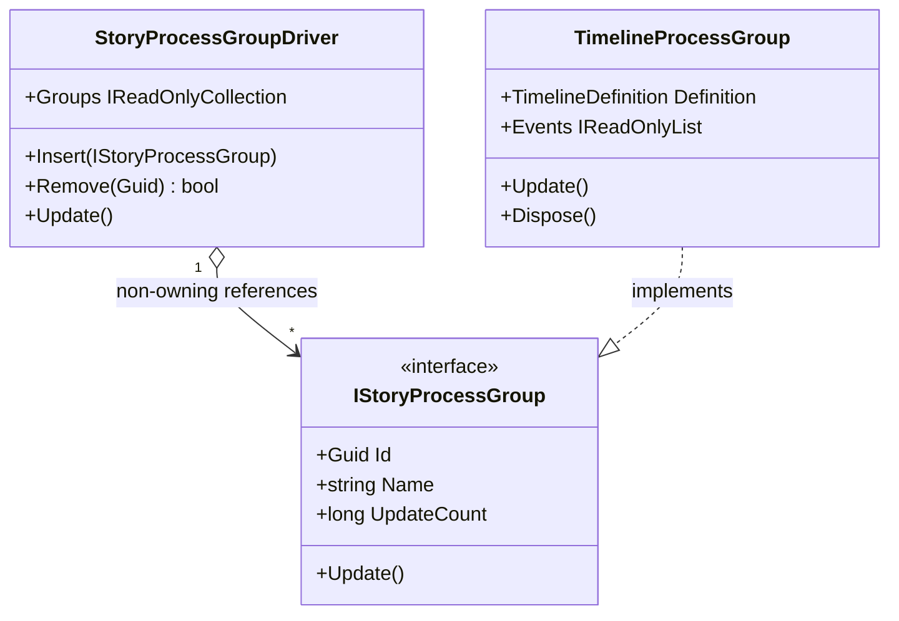

# StoryProcessGroupDriver UML

## Use cases

- Compose independent timeline groups into one driver.
- Advance the groups present at the start of each update pass.
- Remove a group by stable identity without changing the timeline definition.
- Dispose a removed adapter separately when its owning host retires it.

## Ownership and boundary

The driver does not own inserted groups and Remove does not dispose them. The creator/host retains lifetime responsibility. The driver does not own a clock or background loop; its caller controls when Update is called. See [Process Group Lifetime](../PROCESS_GROUP_LIFETIME.md).
