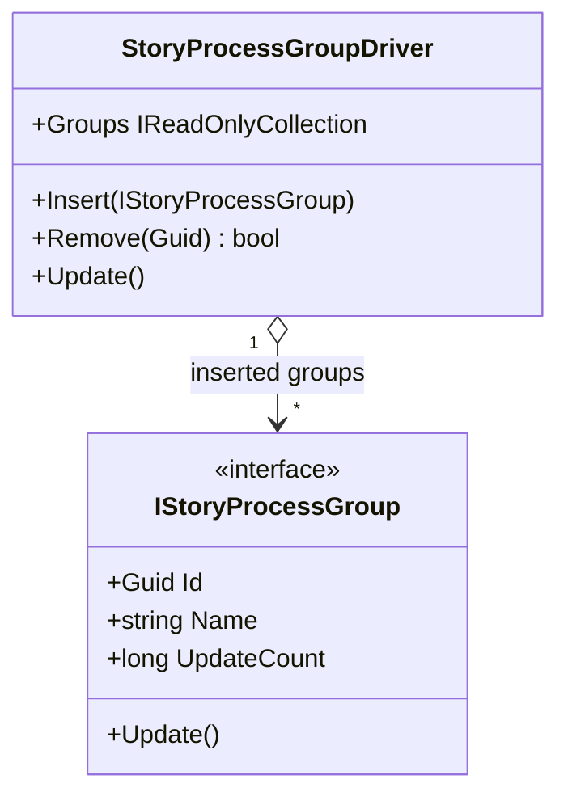

# StoryProcessGroupDriver UML

## Use cases

- Compose independent timeline groups into one driver.
- Advance all currently inserted groups on each driver update.
- Remove a group by stable identity without changing the timeline definition.

## Boundary

The driver does not own a clock or background loop. Its caller controls when Update is called.
