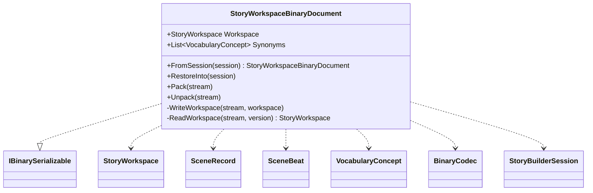

# StoryWorkspaceBinaryDocument UML

## Class diagram

## Use cases

The host captures a workspace and explicit synonym mappings as a versioned binary document. Version 8 persists event IDs on scene beats; versions 1 through 7 remain readable and restore those links as empty. Runtime FSM handles and UI state are not serialized.
