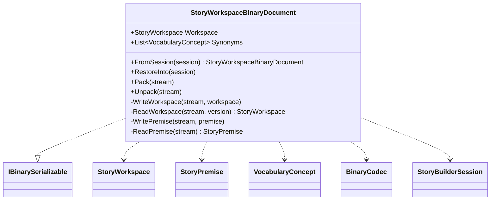

# StoryWorkspaceBinaryDocument UML

## Class diagram

## Use case

The host captures a workspace and its explicit synonym mappings as a versioned binary document. Version 2 persists StoryPremise and CharacterNarrativeRole; version 1 payloads migrate by defaulting roles to Undecided and starting with no premises. On restore, the workspace records are reconstructed and the vocabulary index is rebuilt from source records, then synonym mappings are applied to reconcile the original words. Runtime FSM handles and UI state are not serialized.
