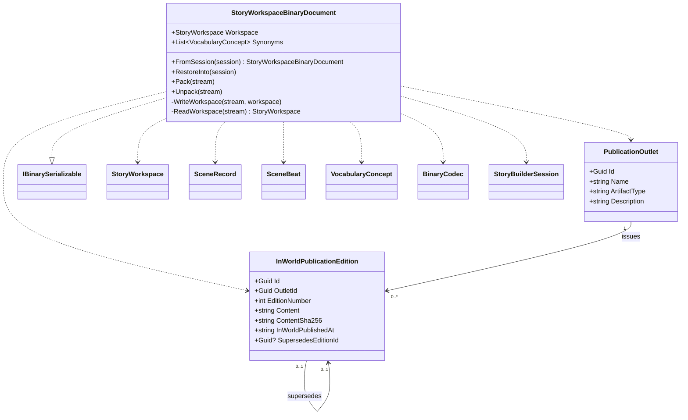

# StoryWorkspaceBinaryDocument UML

## Class diagram

## Current schema

The payload begins with the `SBW1` marker and current schema version `1`. This is the complete current development shape, not a historical compatibility promise. The reader rejects other versions. Unpublished development snapshots may be regenerated when the model changes; the writer, reader, tests, fixtures, and consumers evolve together.

The schema persists the current workspace model, including manuscript publication snapshots, visual asset provenance and review decisions, exact page-composition revision selections, organizations, in-world publication outlets and editions, and explicit vocabulary synonyms. Runtime FSM handles and UI state are not serialized.
