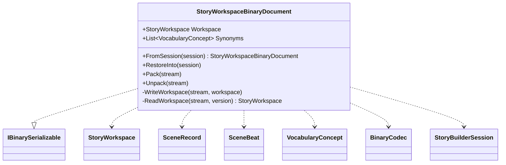

# StoryWorkspaceBinaryDocument UML

## Class diagram

## Use cases

The host captures a workspace and explicit synonym mappings as a versioned binary document. Format 12 persists canonical places, scene place IDs, immutable published Markdown snapshots with SHA-256 integrity and section/scene/event provenance, corrected-edition lineage, and durable planning-point promotion links. Readers retain compatibility with formats 1 through 11; older formats restore newer optional links as empty. Runtime FSM handles and UI state are not serialized.
